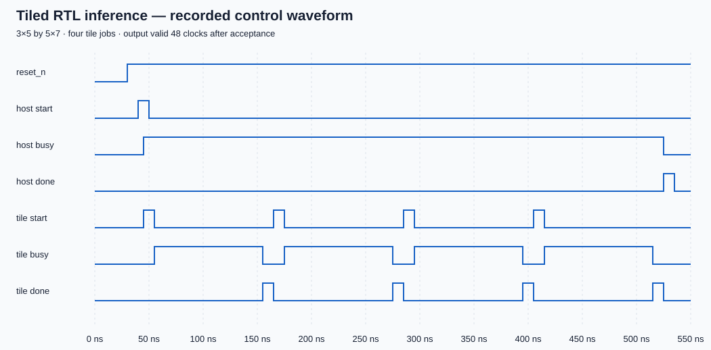
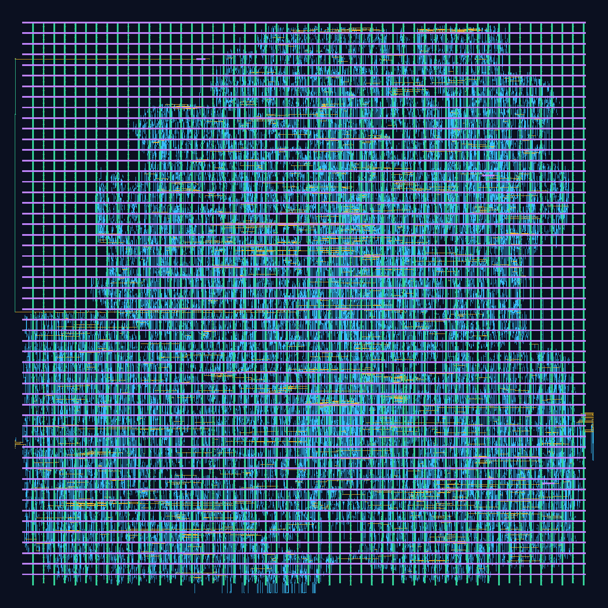

# INT8 Systolic Array Accelerator

A SystemVerilog AI-hardware prototype: a systolic tile, memory-backed GEMM
with two job slots, integer output scaling, a trained digit-classifier demo,
and a routed SKY130 implementation with extracted timing and activity-based power.

[](https://github.com/Kumaryan12/int8_systolic_accelerator/actions/workflows/verify.yml)

```sh
git clone --recurse-submodules https://github.com/Kumaryan12/int8_systolic_accelerator.git
cd int8_systolic_accelerator
make verify
```

`make verify` rebuilds every verification executable and retains a fresh log
folder and JSON summary. Requirements: Python 3.10+, Icarus/vvp, Verilator
5.054, a C++ compiler, and make. No third-party Python packages are needed.
See [toolchain setup](docs/toolchain.md) for versions and individual commands.

## Implemented and verified

| Part | Evidence |
|---|---|
| Default 4×4 signed INT8 tile | 16 MAC units, 18-bit sums, 10 compute clocks after capture |
| RTL size/seed regression | N=2,3,4,8; three seeds; reset at every compute boundary |
| Assertions and coverage | Procedural checker, six temporal properties, 14 scenario bins and nine sign-cross bins; code coverage/LCOV exports |
| UVM | 208 completed transactions, 3,328 output checks and one reset abort per seed; busy-start rejection and recovery |
| Hardware tiled GEMM | Seven shapes, three seeds, 777 completed GEMMs; padding and cross-tile accumulation |
| Memory-backed GEMM | Two tagged job slots, three synchronous RAMs, narrow valid/ready streams; 168 checked GEMMs |
| Memory pipeline performance | Eight-job overlapped schedules take 23–35% fewer cycles than the same interface driven serially; [measured scope](docs/results/checkpoint_8.md) |
| Integer postprocessing | 1,900 Python/RTL comparisons of rounding, saturation, zero points and ReLU |
| RTL layer demo | 21 exact integer outputs; 48 clocks; max float-reference error 0.02152 |
| Trained classifier | All 1,797 official UCI test images run through RTL; 95.05% INT8-logit accuracy |
| Routed implementation | Default memory-backed top: SKY130 GDS/SPEF, zero router DRC errors, +1.061 ns setup slack at 100 MHz |

## Architecture and recorded waveform

A travels right and B travels down through the array; each processing element
keeps its own output sum. The hardware GEMM scheduler feeds zero-padded tiles
and accumulates partial results into a wider output matrix. Input/output ports
are packed row-major buses, with one outstanding job.



[Architecture and performance accounting](docs/architecture.md) ·
[Hardware GEMM contract](docs/hardware_gemm.md) ·
[Memory and host interface](docs/memory_interface.md) ·
[Quantization contract](docs/quantization.md)

## Commands

```sh
make verify                    # Complete functional regression from source
make inference                 # Python/RTL layer comparison, JSON, VCD and SVG
make memory                    # Memory/stream, stalls, reset and overlap tests
make memory-synth              # Check inferred RAM ports and generic fallback
make gate                      # Rebuild and test the mapped base-tile netlist
make sta                       # Synthesis, gate tests and OpenSTA (STA on PATH)
make architecture              # N=2,3,4,8 mapped cell-count/area sweep
make model                     # Train/evaluate and run every official test image in RTL
make physical                  # Pinned Docker SKY130 route/extraction flow
make postroute PHYSICAL_RUN="build/run_<physical-run>"  # Routed gates, timing, power, image
```

Every run creates `build/run_<UTC timestamp>_<unique suffix>/`. Its summary
records source hashes, Git state, UVM revision, seeds, tool versions, commands,
execution times and failures. Build products are ignored by Git. GitHub Actions
runs the functional regression on Ubuntu and archives evidence.

## Implementation results and scope

The default **memory-backed** 3×5 by 5×7 top has a routed SKY130HD result:
20,630 standard cells and 203,764 µm² of standard-cell area. Extracted timing
analysis at **100 MHz** reports **+1.061157 ns setup** and **+0.139495 ns hold**
slack. An eight-job routed-netlist switching trace gives **27.69079 mW** estimated
power, with 53,754 annotated pins and two unannotated pins. These estimates use
TT, 25 C, 1.8 V; reset release is explicitly excepted.



[Physical flow and analysis](physical/README.md) ·
[Trained model and dataset attribution](examples/digits/README.md) ·
[Current status](docs/project_status.md) · [Roadmap](docs/roadmap.md)

The memory uses a standard-cell fallback; hard SRAM/BRAM and AXI/DMA integration
remain target-specific work. Additional PVT corners, reset recovery/removal,
foundry DRC/LVS and real-device measurements remain open. Zero router errors
and typical-corner timing are not production signoff. Historical base-tile
pre-layout numbers are kept in the [checkpoint reports](docs/results/); they
should not be confused with the larger routed memory-backed design or the
different 4×65×10 classifier elaboration.
