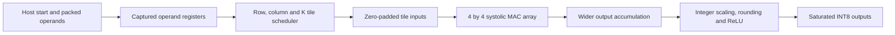
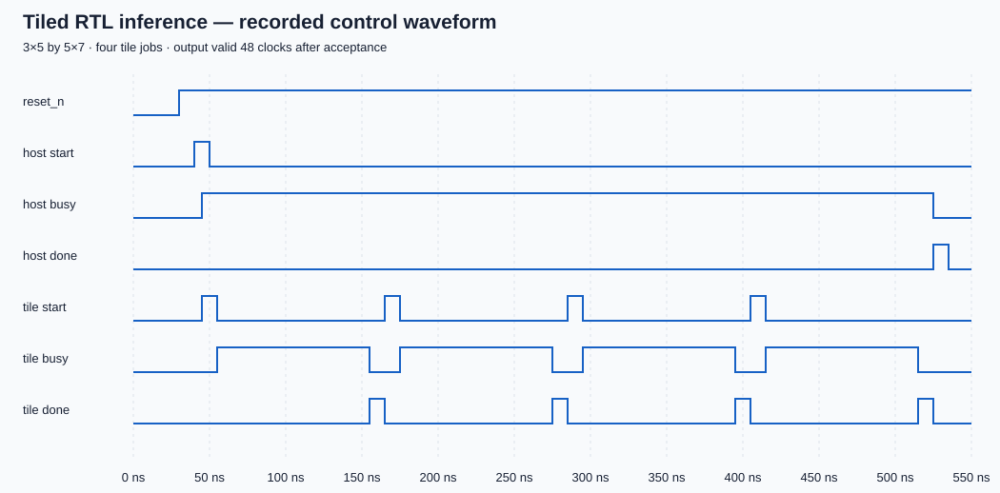

# Architecture and performance accounting

## Data path

`rtl/systolic_array.sv` implements the base tile. Row i injects A[i,k] at
`t=k+i`, column j injects B[k,j] at `t=k+j`, and the operands meet at PE(i,j)
at `t=k+i+j`. A propagates right, B propagates down, and each PE keeps its
own sum. For N=4 the last product arrives at t=9, so 10 compute edges follow
the input-capture edge. Eighteen signed bits safely hold all four INT8 products.

`rtl/tiled_gemm.sv` uses one base tile repeatedly. It stores whole operands in
registers, walks output blocks and K partitions, and accumulates each returned
partial tile. Defaults are 3×5 by 5×7, requiring four padded 4×4 tile jobs.
`rtl/requantize.sv` provides combinational output scaling/saturation. The demo
testbench connects one postprocessor per output; that connection has not been
mapped or timed as a complete layer.

## Recorded timing

This illustration is generated from the passing inference simulation, rather
than hand-drawn signal values. Host acceptance occurs at 45 ns, with `done`
at 525 ns: 480 ns equals 48 clocks of the testbench's 10 ns clock. Four tile
launch/completion pairs are visible. The testbench clock is a simulation setting,
not a measured implementation operating frequency. Every `make inference`
regenerates a full VCD and an SVG in its evidence directory.

## Useful work versus peak arithmetic

| Quantity | Default 4×4 base tile |
|---|---:|
| Physical MAC units | 16 |
| Useful MAC operations per square tile job | 64 |
| Compute clocks after capture | 10 |
| Minimum acceptance-to-acceptance interval | 11 clocks |
| Ideal steady-state useful rate, ignoring transfers | 64/11 ≈ 5.82 MACs/clock |
| Arithmetic utilization over 10 compute clocks | 64/(16×10) = 40% |

The array's peak capacity of 16 MACs/clock is not sustained by a small,
isolated matrix job: wavefront filling/draining and input capture consume
cycles. The GEMM wrapper adds dispatch/collection overhead and takes 12 clocks
per base-tile job. Its 3×5 by 5×7 example performs 105 useful MACs across four
tiles and 48 clocks. Padding reduces useful utilization further.

These are cycle/arithmetic counts derived from the architecture and checked
latencies. No software speedup or transfer-inclusive hardware throughput has
been measured. All standalone base-tile SKY130 timing/area figures exclude the
larger scheduler, output accumulation and postprocessing logic.

## Implementation costs and next work

See [checkpoint 3](results/checkpoint_3.md) for the mapped size sweep and
[hardware GEMM](hardware_gemm.md) for interface details. Register-backed wide
buses and variable indexing make the wrapper expensive (about 134,088 generic
cells in the current default synthesis); generic cells cannot be compared
directly with SKY130 mapped-cell counts. SRAM-oriented buffering and a concrete
host interface have now been implemented in the memory-backed successor; see
`memory_interface.md`. It retains three synchronous RAMs and two tagged slots,
and its generic fallback has 20,025 cells. The SKY130 flow maps those memories
into standard cells and produces GDS/extracted timing. See
`../physical/README.md` for the exact routed top, workload power and limitations.
