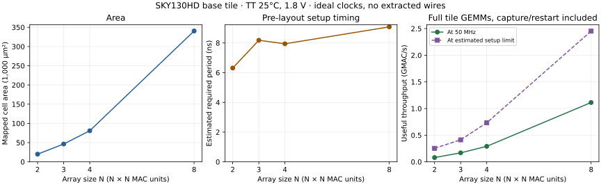

# Checkpoint 16 — CPU comparison, design space and paired accuracy

Four requested software/evaluation improvements are implemented. FPGA execution remains blocked on access to a board; no board is available. There is no separate inference-engine repository, so this project now exports shared workloads for future use.

## Native CPU versus cycle-verified RTL

The machine reports **Apple M5**, arm64. The benchmark is single-threaded C++17, compiled with `clang++ -O3`, with warm repeated operands and nine timed samples. All six shared workloads match both CPU implementations and the actual packed RTL exactly. One MAC means one multiply and accumulate.

| Workload M×K×N | NEON prepacked GEMM (ns) | NEON pack + GEMM + requantize (ns) | CPU full-scope GMAC/s | RTL cycles after acceptance | RTL estimated latency at 50 MHz (ns) |
|---|---:|---:|---:|---:|---:|
| 3×5×7 | 35.864 | 65.113 | 1.6126 | 48 | 960 |
| 4×4×4 | 20.639 | 39.094 | 1.6371 | 12 | 240 |
| 8×8×8 | 101.518 | 182.328 | 2.8081 | 96 | 1920 |
| 1×65×10 | 25.270 | 298.467 | 2.1778 | 612 | 12240 |
| 4×65×10 | 102.394 | 397.687 | 6.5378 | 612 | 12240 |

**The CPU is faster on these small cases.** The accelerator has no measured-device speedup claim. K < 16 uses the NEON implementation’s scalar tail. The CPU full scope excludes allocation, float input quantization and argmax. RTL excludes host transfers and uses an assumed clock; its different classifier elaboration has not been physically timed. CPU comparison uses a fixed 4×4 tile, while the size sweep below changes the base array size.

[Raw CPU metrics](cpu_benchmark.json) retain sample ranges, scalar results, corpus hash, source hashes and compiler/OS metadata. The run writes the complete versioned `workloads.json` interchange corpus.

## Area, timing and useful throughput



| Array N | Cells | Summed cell area (µm²) | Estimated required period (ns) | Useful GMAC/s at 50 MHz | Useful GMAC/s at estimated setup limit |
|---|---:|---:|---:|---:|---:|
| 2 | 2,420 | 19,934.1184 | 6.3100 | 0.0800 | 0.2536 |
| 3 | 5,678 | 46,429.5296 | 8.1800 | 0.1688 | 0.4126 |
| 4 | 9,710 | 80,846.2880 | 7.9414 | 0.2909 | 0.7326 |
| 8 | 41,699 | 340,466.5344 | 9.0800 | 1.1130 | 2.4516 |

The results use SKY130HD TT 25°C, 1.8 V, ideal clocks and no extracted wires. These are pre-layout estimates, separate from routed multi-corner timing. Full tile throughput includes capture/restart, N³ useful MACs per 3N−1 cycles; host transfers and power are excluded. See [raw sweep metrics](design_space.json).

## Quantization accuracy on two architectures

Both models use the same official 3,823 training / 1,797 test split. Fixed hyperparameters and train-only calibration are used; Python float64 provides the float reference. Every test sample is checked through each layer’s packed GEMM/requantization RTL. The host inserts bias and chains the MLP layers.

| Model | Parameters | Float correct | INT8 correct | Float accuracy | INT8 accuracy | Float − INT8 (percentage points) |
|---|---:|---:|---:|---:|---:|---:|
| linear_softmax_64_to_10 | 650 | 1707 | 1708 | 94.9917% | 95.0473% | -0.0556 |
| relu_mlp_64_to_16_to_10 | 1,210 | 1719 | 1721 | 95.6594% | 95.7707% | -0.1113 |

Negative loss means a small gain on this fixed test split: one extra correct image for the linear model, two for the MLP. This does not establish a general improvement from quantization. The recorded approximate paired 95% intervals include zero. This is one seed per architecture on one dataset, not multi-dataset generalization or training-seed robustness.

The checks cover 64,800 accumulator/INT8 output pairs including padding across three layer passes (1,350 four-image GEMMs), with zero mismatches. See [paired metrics](accuracy_study.json). Trained weights remain in ignored build artifacts.

## Energy and FPGA limits

CPU energy remains unavailable because `powermetrics` requires administrator access. No CPU energy-efficiency ratio is reported.

The existing routed streaming-memory trace supports a separate estimate: **587.11 pJ/useful MAC** = 27.69079 mW × 17.81 µs / 840 completed useful MACs. It includes reset, protocol, stalls and idle time at TT/100 MHz, and is a tool estimate from zero-delay gate activity, not measured silicon, AXI power or classifier energy. See [energy provenance](energy_estimate.json).

FPGA execution needs an actual target board. [Bring-up requirements](../fpga_bringup.md) record the remaining steps; no FPGA timing, power or utilization is claimed.

## Reproduction and evidence

```sh
make cpu-bench
make accuracy
STA=/path/to/sta make design-space
```

Plot rendering uses an optional matplotlib environment; functional experiments stay stdlib-only. See [methodology](../performance_methodology.md) for compiler flags, timing scopes, throughput formulas, plotting and energy derivation.

Evidence runs: CPU `run_20261110T165449Z_qjfy5nbu`; sweep `run_20261110T164757Z_xwph_mrp`; accuracy `run_20261110T165205Z_bchshu53`. Reports retain the baseline Git commit, dirty-state description and actual source hashes because the first runs were made while implementing these features.

Full local verification also passed: **232 steps and 44 Python unit tests**, including native signed-extreme/tail/rounding checks and deliberate wrong-reference rejection. Evidence: `build/run_20261110T165539Z_c4zlfrrz`.
