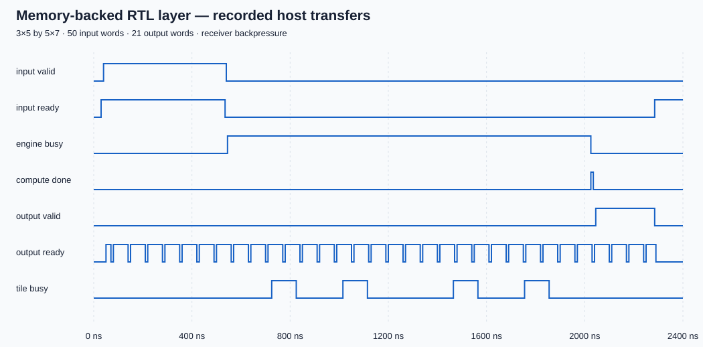

# Checkpoint 8 — measured overlap and memory-backed inference

Validated 10 November 2026 with `make memory-sva memory-bench` and
`make inference`. Seven new temporal properties pass for seeds 2026, 20261110
and 42: input/output stall retention, output index/last/ownership, completion
control, and absence of same-address scratchpad read/write collisions.

## Transfer-inclusive benchmark

Each mode uses the same RAM-backed DUT, eight jobs, the same fixed input seed,
no input bubbles and a ready receiver. The serial host waits until one job's
last output is consumed before sending the next frame. The overlapped host
fills whichever alternating slot is next as soon as it becomes available.
Cycles include all operand loading and output consumption, including pipeline
fill/drain. They are simulated clocks, not wall-clock speedup or device MHz.

| Shape (M,K,N) | Serial batch cycles | Overlapped cycles | Schedule ratio | Steady compute completion interval | Useful MACs/clock, overlapped batch |
|---|---:|---:|---:|---:|---:|
| 3,5,7 | 1,776 | 1,265 | 1.404× | 149 clocks | 0.664 |
| 8,8,8 | 3,928 | 2,570 | 1.528× | 297 clocks | 1.594 |
| 9,2,11 | 4,376 | 3,389 | 1.291× | 406 clocks | 0.467 |

This isolates the scheduling benefit on one interface. It does not compare
against the old parallel-bus wrapper as if their input bandwidths were equal.
The new path trades serialized memory latency for a much smaller logic and
pin footprint. An external bus or memory with different bandwidth/stalls will
change these results. Exact metrics are regenerated by `make memory-bench`
and included in `make verify`.

## Layer demonstration

The same quantized 3×5 by 5×7 ReLU layer now runs through the narrow RAM-backed
host interface and a single streaming integer postprocessor. All 21 integer
accumulator/output pairs match Python and the parallel-bus reference exactly.
For its deterministic stalled receiver it takes 225 transfer-inclusive clocks:
50 accepted input words, 21 output words, with output backpressure exercised.
Maximum float-reference error remains 0.0215193108 and RMSE 0.00751376195.

Evidence: `build/run_20261110T095507Z_gem6uf_y` (temporal assertions),
`build/run_20261110T095511Z_0ux4bmkl` (benchmark), and
`build/run_20261110T095710Z_i1kww38z` (both inference paths and waveforms).
