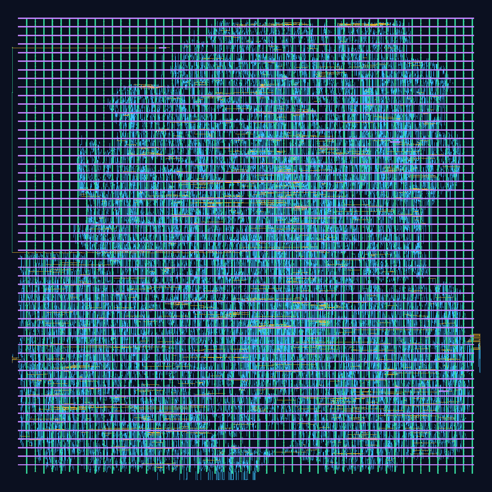

# Routed SKY130 prototype

```sh
# Requires a running Docker engine; the pinned image is pulled if missing.
make physical
# Yosys and Icarus/vvp are also required for routed-netlist workload simulation.
make postroute PHYSICAL_RUN="build/run_<successful-physical-run>"
```

The driver runs the official
[OpenROAD Flow Scripts](https://github.com/The-OpenROAD-Project/OpenROAD-flow-scripts)
container pinned by digest in `toolchain.json`. Its bundled SKY130HD physical
and timing views are used consistently. A source snapshot is copied into a
network-isolated container; the workspace is not bind-mounted. Outputs and
diagnostic reports are copied back before the container is removed.

The target is `memory_gemm` with default M=3,K=5,N=7,TILE=4. Inferred RAMs use
the standard-cell fallback, not hard SRAM macros. The flow includes synthesis,
floorplanning, placement, clock-tree synthesis, detailed routing, parasitic
extraction, final ODB/DEF/GDS and a flow implementation-transformation
equivalence check. The script requires zero routing DRC errors and nonnegative
setup/hold slack, rather than treating file generation alone as success.

Recorded typical-corner result for the pinned run:

| Metric | Result |
|---|---:|
| Clock target | 20 ns / 50 MHz |
| Extracted setup slack | +11.0612 ns |
| Extracted hold slack | +0.139495 ns |
| Estimated minimum clock period | approximately 8.94 ns |
| Estimated maximum frequency | 111.871 MHz |
| Standard-cell count, excluding filler/tap cells | 20,630 |
| Standard-cell area | 203,764 µm² |
| Core area | 520,230 µm² |
| Die area | 550,779 µm² |
| Detailed-router reported DRC errors | 0 |
| Final implementation transformation equivalence | Passed |
| Vectorless power estimate at the 50 MHz target | 13.2859 mW |

These are tool estimates at SKY130HD TT, 25 C, 1.8 V, with extracted interconnect
and propagated clocks. The default power result uses estimated activity; it
is not a workload-based measurement. The flow's equivalence check covers
implementation transformations at mapped circuit cutpoints, not a complete
RTL-to-layout formal proof.

The external asynchronous reset is explicitly excepted in the SDC. Its safe
release and recovery/removal still need a target integration contract.
Additional timing corners, foundry DRC/LVS, package/IO integration and silicon
measurement remain open. Zero detailed-router errors is not full foundry
signoff. The physical configuration describes this default memory-backed top,
not every parameterization or the trained classifier elaboration.

`make physical` creates a new run folder containing `physical_metrics.json`,
all flow logs/reports and `results/sky130hd/int8_memory_gemm/base/6_final.*`.
Large physical artifacts stay out of Git. A manually triggered **SKY130
physical flow** Actions workflow can rebuild and archive them independently.

## Extracted 100 MHz analysis and measured activity

`make postroute` validates physical-artifact checksums, generates functional
cell models from the exact implementation Liberty, and simulates the routed
netlist against the independent integer scoreboard. It then analyzes the same
extracted design with a 10 ns clock constraint, annotates a VCD and renders GDS.
The physical placement/routing is reused; no new optimized layout is implied.

| Metric at 100 MHz | Recorded result |
|---|---:|
| Extracted setup slack | +1.061157 ns |
| Extracted hold slack | +0.139495 ns |
| Workload-annotated pin activities | 53,754 |
| Unannotated pins | 2 |
| Workload-annotated total power | 27.69079 mW |
| Vectorless total power, same frequency | 26.57180 mW |

The activity trace comes from zero-delay simulation of the routed netlist,
including eight matrix jobs and protocol/reset preparations. Extracted wires
are included in power analysis; SDF/glitch-accurate simulation is not. The result
is workload-specific and remains a tool estimate. The annotation gate rejects
reports below 95% measured-pin coverage; this trace reaches 99.9963%.



The rendering shows met2–met5 from the actual generated GDS for readability.
Large GDS/ODB/SPEF/VCD files remain in the run artifacts rather than Git.

## Cell PVT sweep

`make pvt PHYSICAL_RUN=build/run_...` analyzes the same checksummed routed
ODB/SPEF at TT/SS/FF, at 10 and 20 ns. The diagnostic suite reports negative
slacks without failing; its `all_timing_closed` field states closure. Add
`PVT_ARGS="--pvt-periods 20 --require-timing-closure"` for a strict gate. The
manual physical CI workflow gates all three at 50 MHz. SS/FF downloads are
pinned and checked; caches are ignored. This checks cell PVT variation with
unchanged RC and reset exceptions, not full signoff. See [results](../docs/results/checkpoint_12.md).
